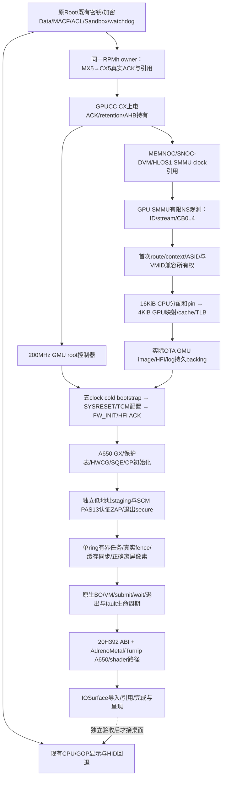

# Adreno 650 接入架构与验收边界

2026-11-03。目标设备为 kebab/SM8250，OS 固定原版 iOS 16.7.16/20H392，XNU 8796.141.3/16 KiB。当前实机为 [0573](qualification/0573/gpucc-qualified.json)，GPU 尚未执行。下图中的依赖箭头描述实现顺序，不表示后续节点已经验收。

## 当前分层

| 层 | 已取得的证据 | 尚缺的证据 |
| --- | --- | --- |
| 安全、存储、CPU显示与输入 | 0573原SCM/Root/Data与watchdog304.443秒回归；既有桌面和手势保留 | 本轮没有重新声明所有GUI人工交互或长期稳定性 |
| CX/MX与GPUCC | 固定floor5真实双ACK、GPUCC CX真实上电ACK、retention与AHB持有，parentrefs2；CAP18/19复制各自首次事件 | GMU/GX、GPU执行与完整电源管理 |
| GPU时钟与SMMU配置总线 | 200MHz root、三clock bus及RO adapter生产候选与主机测试；574独立集成进行中 | 实际native构建和新boot命令结果 |
| GPU SMMU | 独立4KiB表/生命周期候选，明确protected CB5..7不读；实际NS观测接口准备中 | 本机ID/route、首次namespace grant、active CB/TLB/fault和真实DMA |
| 低地址内存 | 原生precopy capture与CAP20在573准确返回旧loader的ABSENT | 83cb loader实际EFI grant、当前SecureDT测量与NC/PAS适用性 |
| GMU、CP与前端 | 固件来源和A650差异已离线核对 | FW/HFI ACK、CP/fence/正确像素及20H392 Metal应用全部未验收 |

## 原始硬件输入

本表来自原始OTA DTB与固定厂商源码，不是允许直接扫描整个窗口的清单。每次MMIO仍需要相应电源、时钟、上下文和有界offset权限。

| 资源 | 原始输入 | 使用范围 |
| --- | --- | --- |
| GPU | `0x03d00000 / 0x40000`，SPI300 / GIC332 | 后续A650 GX/CP精确白名单，当前未访问 |
| GMU | `0x03d6a000 / 0x30000`，SPI304/305 / GIC336/337 | 后续CM3/TCM/HFI；不是有CX引用就可直接访问 |
| GPUCC | `0x03d90000 / 0x9000` | 已验收CX/AHB控制；root与HLOS1 SMMU gate另行验收 |
| GPU SMMU | `0x03da0000 / 0x10000` | 与显示SMMU独立；初期只读普通NS view/CB0..4 |
| GMU/GPU streams | GFX SID0/mask401；GMU user SID4/mask400；GMU kernel SID5/mask400 | SID/mask不等于CB或所有权，须由本机路由和生命周期授予 |
| CPU与GPU页 | CPU16KiB；GPU4KiB；目标36-bit PA/32-bit GMU IOVA | 先核IDR能力；每4KiB实际PA/extent、别名、缓存与TLB都需验证 |

低地址EFI区域和当前8GiB primary范围分开核对。573实际primary physBase为`0x200004000`；不能假设低4GiB分配必然落入主RAM，也不能因EfiLoaderData类型就宣称已安全排除。整个EFI grant、GOP/bootstrap NC、现有owned范围和当前XNU管理范围必须有实际不重叠证明。

## 保持一致的启动协议

采用完整 SM8250/A650 主线200MHz五clock bootstrap profile：AHB、GMU、CXO、AXI、MEMNOC。厂商额外QDSS APB/trace clock不作为这套profile的永久前置；若改走厂商全clock方案，则另外验证其AOP/QMP生命周期。实际CX/MX floor5保留，不把RPMh电平数值误用为selector或降低现有floor。

GMU先有独立IOMMU/domain、完整持久backing及IRQ准备，再建立domain/clocks，按支持的正常cold生命周期进入本方SYSRESET hold，装载/配置后放行并等待真实FW_INIT与HFI响应。不能因`GMU_BCR`名字就假设它覆盖CM3，也不把供应商未要求的“core clock关闭时必须能读CSR”升级为唯一启动入口。

固件使用本机已核对的A650输入。实际GMU/HFI布局与A740不同，HFI四queue分配共16616字节，需要五个4KiB页；不得套mainline常见16KiB backing。每一项已知差异必须明确适配，并用本机ACK验证。PAS13负责后续A650 ZAP认证/secure transition，不是GMU CM3启动复位的替代品。

CP初始化须匹配A650 SQE及所选协议。厂商A650的11payload/mask16f与旧DRM的8payload不是同一初始化合同；A740的7payload/mask14b也不能直接套用。首次不要求抢占或多ring，但必须有真实命令推进和fence完成。

## 资源、回执与完成语义

所有新增clock/power持有共享原RPMh global owner。外部rail引用、CC pin和每个CC child均进入同一引用下限；外部Release不能吞掉子引用，CC Restore不能绕过活跃child。共享GPLL0 keepalive只加不撤，不能用恢复GMU root来关闭别的系统消费者。

CAP18/19/20以及计划的21/22/23都是事件或快照复制，不是live lease。574预计顺序为原300秒回归、GPUPOWER、GPUCCPWR、GMUROOT、GPUBUS、GPUSMMU，再既有回归；每种控制命令只执行一次。CAP19历史ref2、CAP21历史ref3/child1、CAP22历史ref4/child2必须分开解释。只读SMMU快照不授予CB/ASID/stream，也不把三次缓存CRC相同说成三次live寄存器稳定。

映射、提交与释放最终由原生驱动承接：BO必须真实分配/pin、逐4KiB建立GPU映射，提交返回真实fence，CPU读回前完成正确缓存同步。超时或失去owner时保留DMA资源；只有真正producer停止、排空和TLB完成后才可解除映射及释放。GPU写入测试、像素渲染与桌面呈现分别验收。

20H392前端在底层离屏像素成功后独立推进。AdrenoMetal/Turnip只能在明确的IOGPU/Metal/IOSurface ABI、BO导入与shader编译路径上适配；注册设备或发布伪MTLDevice不能代替加速。先独立Metal进程，再接原版backboardd，保留CPU显示回退。

## 固定参考

- [UniXNU GPU适配](https://unixnu.com/zh/porting/gpu)：硬件、BO/VM、提交/fence与前端的分层验收。
- [AdrenoPM4](https://github.com/UniXNU/AdrenoPM4/tree/282606b528b2595bc4274ea7490b62b323f35a5f)：通用包编码，结构解码成功不授权寄存器/地址或硬件提交。
- [固定厂商内核](https://github.com/The-Anomalist/Singularity/tree/7c2b1aedb5573d140684a9ecc918ce22af5f0817)：Kona GPUCC/GDSC、GMU/HFI、原始stream与CP路径。
- [Linux v6.12](https://github.com/torvalds/linux/tree/adc218676eef25575469234709c2d87185ca223a)：SM8250五clock/200MHz和A6xx正常cold生命周期。厂商输入差异另行记录，不直接移植A7xx分支。

完整A740→A650差异、原始固件哈希和资源审计保存在项目工作台的固定输入报告。该文档不包含专有固件、密钥或私人Data。
